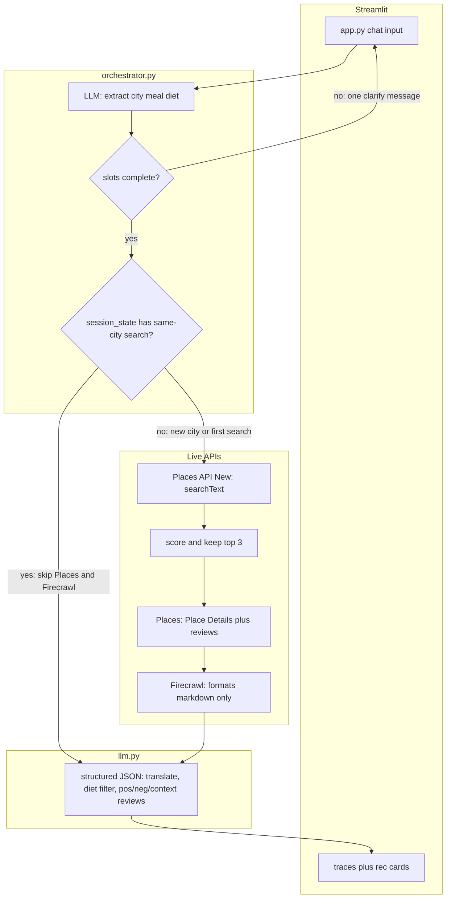

# Traveller restaurant agent

Tell it a **city**, **breakfast / lunch / dinner**, and your **diet**. It will not fill in Barcelona or vegetarian for you. If something is missing, it asks once, then finds places, reads menus, and suggests what to order.

## How it works



**Google Places** finds restaurants and a shortlist (ratings, website, a handful of reviews). If Google has tagged a place as vegetarian or as serving lunch, we only use that to **rank** candidates. Those tags are often missing or wrong, so what we actually suggest comes from the **menu page**.

**Firecrawl** downloads the restaurant site as markdown (1 credit a page). We do not use Firecrawl JSON extract — it costs extra. At most three pages per place: homepage, then a menu URL if the homepage has no prices, then one more if that URL is only an index (few prices, more food-menu links). Worst case is 9 credits for a 3-restaurant search; follow-ups reuse session memory.

**Gemini or OpenAI** translates the menu, filters to your diet, splits good and bad reviews, and writes the suggestions. Follow-ups in the same session reuse that data so we do not scrape again.

The Streamlit page shows each of those steps under **How this answer was built**, then the restaurant cards (items, prices, links).

## Run

```bash
python -m venv .venv
.venv\Scripts\activate
pip install -r requirements.txt
copy .env.example .env
streamlit run app.py
```

Put keys in `.env`. Default model path is Gemini (`LLM_PROVIDER=gemini` + `GEMINI_API_KEY` from AI Studio). That is **not** the same key as Places. If Gemini hits its free daily cap, set `LLM_PROVIDER=openai` and `OPENAI_API_KEY`. You also need `FIRECRAWL_API_KEY` and `GOOGLE_PLACES_API_KEY` (enable **Places API New** on a billed GCP project).

## Assumptions

- We search only after city, meal, and diet are clear.
- Prices come from the restaurant’s own site, not delivery apps.
- Memory is a **session**: Streamlit keeps Places results, menus, and recs in memory for this run of the app in this window. Follow-ups reuse that. Refresh the page, close the window, or restart Streamlit and you get a new session (we scrape again).

## Limitations

- Google only gives a few reviews via the PlacesAPI.
- To stay on Firecrawl's free tier, we only scrape HTML text - PDF menus are skipped, and image/Instagram menus fail because they lack text to scrape
- We cap Firecrawl at three restaurants and md-only, to stay on the free tier.
- The model can miss hidden meat or dairy. This is not allergen advice.
- Prices can be old. We cannot book a table.
- Since its a takehome assessment, it is not production grade - no auth, no evals, no disk cache, and many more.